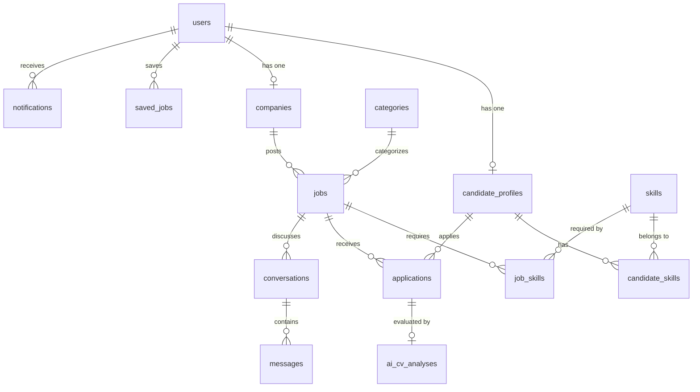

# TÀI LIỆU TOÀN DIỆN DÀNH CHO BACKEND DEVELOPER (TỪ A - Z)
> **Dự án:** Sàn Tìm Kiếm Việc Làm Online (TimViecOnline)  
> **Backend Framework:** Laravel 11 RESTful API (PHP >= 8.2) | **Database:** MySQL (XAMPP / phpMyAdmin)  
> **Authentication:** Laravel Sanctum | **Realtime:** Laravel Reverb (WebSocket) | **AI Engine:** Google Gemini 1.5 Flash  
> **Tài liệu đối chiếu:** [docs/SRS.md](file:///D:/xampp/htdocs/tim-viec-online/docs/SRS.md) | [BACKEND_TESTING_GUIDE.md](file:///D:/xampp/htdocs/tim-viec-online/BACKEND_TESTING_GUIDE.md) | [db/tim_viec_online.sql](file:///D:/xampp/htdocs/tim-viec-online/db/tim_viec_online.sql)

---

## MỤC LỤC
1. [Kiến trúc hệ thống & Bản đồ thư mục](#1-kiến-trúc-hệ-thống--bản-đồ-thư-mục)
2. [Hướng dẫn cài đặt & Khởi chạy nhanh (Quick Start)](#2-hướng-dẫn-cài-đặt--khởi-chạy-nhanh-quick-start)
3. [Thuật ngữ, Phân vai & Ràng buộc chung](#3-thuật-ngữ-phân-vai--ràng-buộc-chung)
4. [Đặc tả chi tiết Nghiệp vụ Backend (FR-01 đến FR-10)](#4-đặc-tả-chi-tiết-nghiệp-vụ-backend-fr-01-đến-fr-10)
   - [FR-01: Đăng ký tài khoản & Tự động tạo hồ sơ](#fr-01-đăng-ký-tài-khoản)
   - [FR-02: Đăng nhập, Tạm khóa 5 lần, Quên mật khẩu & Đổi mật khẩu](#fr-02-đăng-nhập-tạm-khóa-quên-mật-khẩu--đổi-mật-khẩu)
   - [FR-03: Hồ sơ ứng viên & Tải lên file CV PDF](#fr-03-hồ-sơ-ứng-viên--tải-lên-file-cv-pdf)
   - [FR-04: Hồ sơ công ty & Vòng đời tin tuyển dụng (Active/Closed)](#fr-04-hồ-sơ-công-ty-đăng-tin--quản-lý-vòng-đời-tin-tuyển-dụng)
   - [FR-05: Tìm kiếm, Bộ lọc đa tiêu chí & Đẩy tin tự động (Bump Job)](#fr-05-tìm-kiếm--bộ-lọc-việc-làm)
   - [FR-06: Ứng tuyển & Quản lý vòng đời hồ sơ](#fr-06-ứng-tuyển--quản-lý-vòng-đời-hồ-sơ)
   - [FR-07: Tích hợp Google Gemini AI phân tích CV (Match Score)](#fr-07-ai-phân-tích-cv--chấm-điểm-độ-phù-hợp-match-score)
   - [FR-08: Nhắn tin thời gian thực qua WebSocket Reverb](#fr-08-nhắn-tin-thời-gian-thực-real-time-chat)
   - [FR-09: Quản trị hệ thống, Kiểm duyệt tin & Master Data (Admin)](#fr-09-quản-trị-hệ-thống--kiểm-duyệt-tin-admin)
   - [FR-10: Hệ thống thông báo Web In-App (Notifications)](#fr-10-hệ-thống-thông-báo-trên-web-web-notifications)
5. [Yêu cầu phi chức năng (NFR-01 đến NFR-08) & Bảo mật](#5-yêu-cầu-phi-chức-năng-non-functional-requirements)
6. [Thiết kế Cơ sở dữ liệu chi tiết (Schema 15 bảng & Eloquent Models)](#6-thiết-kế-cơ-sở-dữ-liệu-chi-tiết)
7. [Đặc tả Danh sách RESTful API Endpoints đầy đủ (A-Z)](#7-đặc-tả-danh-sách-restful-api-endpoints-đầy-đủ)
8. [Quy chuẩn Response JSON & Bảng ánh xạ mã lỗi chuẩn SRS](#8-quy-chuẩn-response-json--bảng-ánh-xạ-mã-lỗi-chuẩn-srs)
9. [Hướng dẫn kỹ thuật lõi đặc thù (Gemini AI, Reverb WebSocket, Storage)](#9-hướng-dẫn-kỹ-thuật-lõi-đặc-thù)
10. [Dữ liệu kiểm thử mẫu & Bộ kiểm thử tự động 58 bài test](#10-dữ-liệu-kiểm-thử-mẫu--bộ-kiểm-thử-tự-động-58-bài-test)
11. [Kế hoạch phân công, Lộ trình 3 tuần & Quy tắc Git](#11-kế-hoạch-phân-công-lộ-trình-3-tuần--quy-tắc-git)

---

## 1. Kiến trúc hệ thống & Bản đồ thư mục

### 1.1. Công nghệ sử dụng
* **Kiến trúc Monorepo:** Cả Backend và Frontend nằm chung một Git Repository.
  * `backend/`: Laravel 11 RESTful API Service (PHP >= 8.2).
  * `frontend/`: Next.js 14+ App Router, Tailwind CSS, Axios, Laravel Echo.
  * `db/`: File dump cơ sở dữ liệu `tim_viec_online.sql`.
* **Xác thực:** Laravel Sanctum (Bearer Token).
* **Realtime Server:** Laravel Reverb (WebSocket server tích hợp chính chủ Laravel).
* **AI Engine:** Google Gemini API (`gemini-1.5-flash`) truyền trực tiếp văn bản trích xuất từ CV PDF để phân tích 4 tiêu chí trọng số và chấm điểm độ tương thích (kèm Heuristic Fallback khi không có API Key).

### 1.2. Bản đồ cây thư mục Backend (`/backend`)
```text
backend/
├── app/
│   ├── Events/                                    # Broadcast Events qua WebSocket Reverb
│   │   ├── MessageSent.php                        # Sự kiện gửi tin nhắn mới (kênh chat.{id})
│   │   ├── MessagesRead.php                       # Sự kiện đã xem tin nhắn (kênh chat.{id})
│   │   └── NotificationSent.php                   # Sự kiện thông báo in-app (kênh App.Models.User.{id})
│   ├── Http/
│   │   ├── Controllers/
│   │   │   └── Api/
│   │   │       ├── AuthController.php             # Đăng ký, đăng nhập, đổi pass, quên pass, profile
│   │   │       ├── CandidateProfileController.php # Hồ sơ ứng viên, upload CV PDF, chọn 10 kỹ năng
│   │   │       ├── CompanyController.php          # Hồ sơ công ty, danh sách công ty công khai
│   │   │       ├── JobController.php              # CRUD tin tuyển dụng, tìm kiếm lọc, bump tin, lưu tin
│   │   │       ├── ApplicationController.php      # Nộp đơn, rút đơn, duyệt đơn, gọi Gemini AI
│   │   │       ├── ChatController.php             # Danh sách hội thoại, gửi/nhận tin nhắn & ảnh realtime
│   │   │       ├── NotificationController.php     # Danh sách thông báo, lọc read/unread, đánh dấu đã đọc
│   │   │       ├── CategoryController.php         # Ngành nghề (Public & Admin CRUD)
│   │   │       ├── SkillController.php            # Kỹ năng (Public & Admin CRUD)
│   │   │       └── AdminController.php            # Thống kê stats, khóa/mở user, xóa tin vi phạm
│   │   ├── Middleware/
│   │   │   ├── CheckRole.php                      # Phân quyền: candidate, employer, admin
│   │   │   └── CheckUserLocked.php                # Chặn tài khoản bị Admin khóa
│   │   ├── Requests/                              # FormRequest validate & custom response chuẩn SRS
│   │   │   ├── RegisterRequest.php                # Validate đăng ký chuẩn RFC & regex password
│   │   │   ├── LoginRequest.php                   # Validate đăng nhập email/password
│   │   │   ├── ForgotPasswordRequest.php          # Validate email quên mật khẩu
│   │   │   ├── ResetPasswordRequest.php           # Validate token & mật khẩu mới
│   │   │   ├── ChangePasswordRequest.php          # Validate mật khẩu hiện tại & mật khẩu mới
│   │   │   ├── CompanyProfileRequest.php          # Validate hồ sơ công ty bắt buộc trước khi đăng tin
│   │   │   ├── JobRequest.php                     # Validate hạn nộp > today, lương min <= max
│   │   │   └── ApplyJobRequest.php                # Validate quyền candidate & file CV PDF <= 5MB
│   │   └── Resources/                             # API Resource format JSON đồng nhất
│   │       ├── ApplicationResource.php            # Format đơn ứng tuyển & kết quả AI Match Score
│   │       ├── CompanyResource.php                # Format thông tin doanh nghiệp
│   │       └── JobResource.php                    # Format tin tuyển dụng, định dạng lương & trạng thái
│   ├── Mail/
│   │   └── ResetPasswordMail.php                  # Mailable gửi liên kết đặt lại mật khẩu
│   ├── Models/                                    # 15 Eloquent Models thiết lập đầy đủ quan hệ
│   │   ├── User.php
│   │   ├── CandidateProfile.php
│   │   ├── Company.php
│   │   ├── Category.php
│   │   ├── Skill.php
│   │   ├── Job.php
│   │   ├── Application.php
│   │   ├── SavedJob.php
│   │   ├── AiCvAnalysis.php
│   │   ├── Conversation.php
│   │   ├── Message.php
│   │   └── Notification.php
│   └── Services/
│       └── GeminiService.php                      # Đọc text từ CV PDF, prompt Gemini 1.5 Flash
├── config/
│   ├── queue.php                                  # Cấu hình queue database (queue_jobs)
│   ├── broadcasting.php                           # Driver Reverb kết nối WebSocket
│   └── cors.php                                   # CORS cho phép Frontend Next.js gọi API
├── database/
│   ├── migrations/                                # 15 bảng migration theo thứ tự khóa ngoại
│   └── seeders/                                   # CategorySeeder, SkillSeeder, DatabaseSeeder
├── resources/
│   └── views/
│       └── emails/
│           └── reset_password.blade.php           # Giao diện email đặt lại mật khẩu HTML chuẩn
├── routes/
│   ├── api.php                                    # Toàn bộ danh sách RESTful API endpoints
│   └── channels.php                               # Kênh riêng tư WebSocket (chat.{id}, User.{id})
├── storage/app/public/                            # Lưu trữ file công khai (avatars, logos, cvs, chat_images)
└── test_all_backend.php                           # Bộ kiểm thử tự động toàn diện 58 bài test
```

---

## 2. Hướng dẫn cài đặt & Khởi chạy nhanh (Quick Start)

### 2.1. Cấu hình file `backend/.env`
Sao chép `.env.example` thành `.env` và kiểm tra các thông số bắt buộc:
```ini
APP_NAME=TimViecOnline
APP_ENV=local
APP_KEY=base64:... # Sinh bằng: php artisan key:generate
APP_DEBUG=true
APP_URL=http://localhost:8000
FRONTEND_URL=http://localhost:3000

# Kết nối MySQL (Khởi động MySQL trong XAMPP trước)
DB_CONNECTION=mysql
DB_HOST=127.0.0.1
DB_PORT=3306
DB_DATABASE=tim-viec-online
DB_USERNAME=root
DB_PASSWORD=
DB_COLLATION=utf8mb4_unicode_ci

# Hệ thống lưu trữ file công khai (Avatar, Logo, CV PDF, Chat Images)
FILESYSTEM_DISK=public

# WebSocket Laravel Reverb (Realtime Chat & Notifications)
BROADCAST_CONNECTION=reverb
REVERB_APP_ID=timviec_app
REVERB_APP_KEY=timviec_key
REVERB_APP_SECRET=timviec_secret
REVERB_HOST="localhost"
REVERB_PORT=8080
REVERB_SCHEME=http

# Google Gemini API Key (Dùng để phân tích CV & chấm Match Score)
GEMINI_API_KEY=your_gemini_api_key_here
```

### 2.2. Các bước khởi tạo lần đầu (Terminal commands)
```bash
# 1. Di chuyển vào thư mục backend
cd backend

# 2. Cài đặt các thư viện phụ thuộc PHP
composer install

# 3. Tạo symbolic link cho thư mục lưu trữ file (BẮT BUỘC để xem được avatar/CV/ảnh chat)
php artisan storage:link

# 4. Khởi tạo cấu trúc bảng và nạp dữ liệu mẫu
php artisan migrate:fresh --seed

# 5. Khởi chạy máy chủ Backend API (Port 8000)
php artisan serve --port=8000

# 6. Khởi chạy máy chủ WebSocket Reverb (Mở 1 cửa sổ Terminal riêng)
php artisan reverb:start
```

---

## 3. Thuật ngữ, Phân vai & Ràng buộc chung

### 3.1. Thuật ngữ cốt lõi (Terminology)
| Thuật ngữ | Định nghĩa nghiệp vụ |
|---|---|
| **Khách (Guest)** | Người dùng chưa đăng nhập vào hệ thống. |
| **Ứng viên (Candidate)** | Người tìm việc có tài khoản, hồ sơ kỹ năng, file CV PDF và lịch sử ứng tuyển. |
| **Nhà tuyển dụng (Employer)** | Doanh nghiệp có tài khoản, hồ sơ công ty và quyền đăng/quản lý tin tuyển dụng. |
| **Quản trị viên (Admin)** | Người quản trị hệ thống, có quyền kiểm duyệt tin tuyển dụng, khóa/mở khóa tài khoản và quản lý danh mục. |
| **JD (Job Description)** | Bản mô tả công việc, yêu cầu kỹ năng, kinh nghiệm và chế độ đãi ngộ của vị trí tuyển dụng. |
| **CV (Curriculum Vitae)** | Hồ sơ năng lực của ứng viên, định dạng bắt buộc là file PDF dung lượng dưới 5MB. |
| **Match Score** | Điểm số tương thích giữa CV của ứng viên và tin tuyển dụng do AI chấm (thang điểm 0 - 100%). |
| **WebSocket** | Kênh truyền dữ liệu hai chiều tức thời (qua Laravel Reverb) phục vụ nhắn tin và thông báo realtime. |

### 3.2. Phân vai người dùng & Quyền hạn
* **Guest:** Xem trang chủ, tìm kiếm việc làm, lọc việc làm, xem chi tiết công việc, xem chi tiết công ty, đăng ký tài khoản, đăng nhập, quên mật khẩu, xác thực link đặt lại mật khẩu.
* **Candidate:** Toàn bộ quyền của Guest + Cập nhật hồ sơ cá nhân, chọn tối đa 10 kỹ năng, upload CV mặc định, xem trước CV, lưu/bỏ lưu việc làm, nộp đơn ứng tuyển (chọn CV profile hoặc upload mới), rút đơn ứng tuyển (khi còn `applied`), xem kết quả AI Match Score, nhắn tin 1-1 và gửi ảnh cho Nhà tuyển dụng, nhận thông báo in-app.
* **Employer:** Toàn bộ quyền của Guest + Cập nhật thông tin công ty (bắt buộc trước khi đăng bài), đăng tin tuyển dụng, chỉnh sửa tin, đóng/mở tin, xem danh sách ứng viên nộp vào tin của mình, xem CV (tự động chuyển trạng thái `waiting`), đổi trạng thái hồ sơ (`waiting`, `accepted`, `rejected`), nhắn tin 1-1 và gửi ảnh cho ứng viên, nhận thông báo in-app.
* **Admin:** Dashboard thống kê tổng quan, quản lý người dùng (xem, tìm kiếm, khóa/mở khóa tài khoản kèm thu hồi token), kiểm duyệt tin tuyển dụng (xóa tin vi phạm), CRUD danh mục ngành nghề (Categories) và kỹ năng (Skills).

### 3.3. Ràng buộc hệ thống chung
1. **Độ tuổi:** Người dùng đăng ký phải từ **15 tuổi trở lên** (theo Luật Lao động Việt Nam).
2. **File CV:** Định dạng bắt buộc là **PDF**, dung lượng file **tối đa 5 MB (5.120 KB)**.
3. **Tiền tệ & Ngày tháng:** Đơn vị tiền tệ hiển thị là **VNĐ** (ví dụ: `15.000.000 VNĐ` hoặc `15 - 25 triệu VNĐ`). Ngày tháng lưu trữ ISO 8601, hiển thị `DD/MM/YYYY`.
4. **Phạm vi hệ thống (Out of Scope):** Tập trung vào Upload CV PDF cá nhân hóa và Phân tích tương thích qua AI; **không** làm công cụ tạo CV kéo thả trực tuyến (CV Builder).

---

## 4. Đặc tả chi tiết Nghiệp vụ Backend (FR-01 đến FR-10)

### FR-01: Đăng ký tài khoản
* **Endpoint:** `POST /api/register`
* **Quy chuẩn dữ liệu đầu vào (`RegisterRequest`):**
  * `name`: Bắt buộc, độ dài **2 - 100 ký tự**, không chứa ký tự đặc biệt ngoài khoảng trắng và dấu gạch nối (Regex: `^[\pL\s-]+$`).
  * `email`: Bắt buộc, chuẩn RFC, kiểm tra **unique** trong bảng `users` (không phân biệt chữ hoa/thường). Nếu trùng, trả về HTTP 422: `"Email đã được sử dụng"`.
  * `password`: Bắt buộc, độ dài **8 - 32 ký tự**, chứa ít nhất 1 chữ thường, 1 chữ hoa, 1 chữ số, 1 ký tự đặc biệt (Regex: `^(?=.*[a-z])(?=.*[A-Z])(?=.*\d)(?=.*[@$!%*?&])[A-Za-z\d@$!%*?&]{8,32}$`).
  * `password_confirmation`: Bắt buộc, trùng khớp 100% với `password`.
  * `phone`: Tùy chọn. Nếu có, đúng **10 chữ số** và bắt đầu bằng các đầu số hợp lệ của Việt Nam: `03`, `05`, `07`, `08`, `09`. Nếu sai, báo lỗi `"Số điện thoại không hợp lệ"`.
  * `dob`: Tùy chọn. Nếu có, phải đảm bảo đủ 15 tuổi trở lên (`before_or_equal:-15 years`).
  * `role`: Bắt buộc, chỉ nhận giá trị: `candidate` hoặc `employer`.
* **Hành vi xử lý Backend:**
  * Mã hóa mật khẩu bằng thuật toán `Hash::make()` (Bcrypt).
  * Khởi tạo `status = 'active'`, `failed_attempts = 0`.
  * **Tự động tạo bản ghi hồ sơ rỗng:**
    * Nếu `role == 'candidate'`: Tạo bản ghi trong `candidate_profiles` với `user_id = $user->id`.
    * Nếu `role == 'employer'`: Tạo bản ghi trong `companies` với `user_id = $user->id`, gán `name = $user->name`.
  * Cấp Sanctum Bearer Token và trả về HTTP 201 Created.

### FR-02: Đăng nhập, Tạm khóa, Quên mật khẩu & Đổi mật khẩu
* **Đăng nhập (`POST /api/login`):**
  * Kiểm tra email và mật khẩu (`Hash::check`).
  * Nếu sai: Tăng `failed_attempts` lên 1. Trả về HTTP 401 với thông báo chuẩn: `"Email hoặc mật khẩu không chính xác"` (FR-02.2).
  * **Tạm khóa sau 5 lần sai liên tiếp (FR-02.3 & FR-02.4):** Nếu `failed_attempts >= 5`, cập nhật `locked_until = now()->addMinutes(15)`. Khi user cố đăng nhập trong thời gian này, trả về HTTP 403: `"Tài khoản bị tạm khóa do nhập sai nhiều lần, vui lòng khôi phục tài khoản"`. Đăng nhập đúng sẽ reset `failed_attempts = 0` và `locked_until = null`.
  * **Kiểm tra tài khoản bị Admin khóa (FR-02.5):** Nếu `status == 'locked'`, trả về HTTP 403: `"Tài khoản của bạn đã bị khóa bởi quản trị viên"`.
  * **Cấp phát Token & Điều hướng tự động (FR-02.6):** Đăng nhập thành công trả về Bearer Token và trường `redirect_url`:
    * Ứng viên (`candidate`): `/jobs`
    * Nhà tuyển dụng (`employer`): `/employer/my-jobs`
    * Quản trị viên (`admin`): `/admin/dashboard`
* **Đăng xuất (`POST /api/logout`):** Thu hồi Sanctum token hiện tại.
* **Đổi mật khẩu khi đăng nhập (`PUT /api/user/change-password` - FR-02.9):**
  * Nhập: `current_password`, `new_password` (hoặc `password`), `new_password_confirmation`.
  * Kiểm tra `current_password` đúng. Nếu sai, trả HTTP 400: `"Mật khẩu hiện tại không chính xác"`.
  * Kiểm tra mật khẩu mới không được trùng mật khẩu cũ. Nếu trùng, trả HTTP 400: `"Mật khẩu mới không được trùng với mật khẩu hiện tại"`.
  * Mật khẩu mới thỏa mãn chuẩn độ mạnh (FR-01.4).
  * Cập nhật mật khẩu mới, tạo thông báo in-app bảo mật và trả HTTP 200: `"Đổi mật khẩu thành công"`.
* **Quên mật khẩu & Đặt lại (FR-02.7 & FR-02.8):**
  * **Gửi yêu cầu:** `POST /api/forgot-password` (hoặc `/api/password/forgot`).
    * Nhập `email`. Nếu không tìm thấy, trả HTTP 404: `"Email không tồn tại trong hệ thống"`.
    * Sinh chuỗi ngẫu nhiên 64 ký tự lưu vào `password_reset_tokens` (hiệu lực **15 phút**).
    * Gửi email qua Mailable `ResetPasswordMail` (Blade template `reset_password.blade.php`) chứa liên kết `/reset-password?token=...&email=...`.
  * **Kiểm tra liên kết xác thực:** `GET|POST /api/verify-reset-token`.
    * Kiểm tra tính hợp lệ và thời hạn 15 phút của token. Nếu hết hạn hoặc sai, trả HTTP 400: `"Liên kết xác thực đã hết hạn hoặc không hợp lệ"`.
  * **Đặt lại mật khẩu mới:** `POST /api/reset-password` (hoặc `/api/password/reset`).
    * Nhập `email`, `token`, `password`, `password_confirmation`.
    * Nếu token sai hoặc quá 15 phút, trả HTTP 400: `"Liên kết xác thực đã hết hạn hoặc không hợp lệ"`.
    * Cập nhật mật khẩu mới, xóa token, đặt lại `failed_attempts = 0` và `locked_until = null` (khôi phục tài khoản).
    * Tạo thông báo bảo mật và trả HTTP 200: `"Đặt lại mật khẩu thành công"` kèm `redirect_url: '/login'`.

### FR-03: Hồ sơ ứng viên & Tải lên file CV PDF
* **Xem hồ sơ cá nhân:** `GET /api/candidate/profile`
* **Cập nhật hồ sơ & Tải lên CV:** `POST /api/candidate/profile` (`multipart/form-data`)
  * Các trường: `title`, `experience_years`, `bio`, `city`, `avatar` (ảnh: jpeg, png, jpg, webp, max 2MB), `skills` (mảng ID, tối đa **10 kỹ năng**).
  * **File CV mặc định:**
    * Bắt buộc định dạng `.pdf`. Dung lượng tối đa **5 MB (5.120 KB)**.
    * Nếu sai định dạng hoặc > 5MB, trả về HTTP 400: `"Chỉ chấp nhận file định dạng PDF dung lượng dưới 5MB"`.
    * Lưu file vào `storage/app/public/cvs/` và lưu đường dẫn vào `cv_file_path`.
    * Trả về đường dẫn xem trực tiếp (PDF Preview URL) dạng `http://localhost:8000/storage/cvs/....pdf` để trình duyệt xem trực tiếp, không ép tải về.

### FR-04: Hồ sơ công ty, Đăng tin & Quản lý vòng đời tin tuyển dụng
* **Hồ sơ doanh nghiệp:**
  * `GET /api/employer/company`: Xem thông tin công ty của NTD đang đăng nhập.
  * `POST /api/employer/company`: Cập nhật Tên công ty, Logo, Website, Quy mô (`company_size`), Địa chỉ trụ sở, Tỉnh/Thành phố, Giới thiệu.
  * **Ràng buộc FR-04.1:** Nhà tuyển dụng **bắt buộc** phải có đủ Tên công ty, Giới thiệu, Địa chỉ trụ sở và Tỉnh/Thành phố trước khi được phép đăng tin tuyển dụng đầu tiên. Nếu thiếu, trả HTTP 400: `"Vui lòng cập nhật đầy đủ thông tin công ty (Tên, Giới thiệu, Trụ sở, Tỉnh/Thành phố) trước khi đăng tin tuyển dụng đầu tiên"`.
* **Đăng tin tuyển dụng mới:** `POST /api/employer/jobs`
  * Tiêu đề việc làm: Bắt buộc, độ dài **10 đến 200 ký tự**.
  * Hạn chót nộp hồ sơ (`deadline`): Bắt buộc sau ngày hôm nay (`after:today`). Nếu chọn hôm nay hoặc quá khứ, trả về HTTP 400: `"Hạn nộp hồ sơ phải sau ngày hôm nay"`.
  * **Định dạng mức lương (3 trường hợp - FR-04.4):**
    1. *Khoảng lương cụ thể:* Nhập `salary_min` và `salary_max`. Bắt buộc `salary_min <= salary_max` và > 0. Nếu min > max, trả HTTP 400: `"Mức lương tối thiểu không được lớn hơn mức lương tối đa"`. Hiển thị: `"15 - 25 triệu VNĐ"`.
    2. *Lương khởi điểm:* Nhập `salary_min`, để trống `salary_max` (`salary_type = 'from'`). Hiển thị: `"Từ 18 triệu VNĐ"`.
    3. *Lương thỏa thuận:* `salary_type = 'negotiable'` hoặc `is_negotiable = true`. Cả min và max đều `NULL`. Hiển thị: `"Thỏa thuận"`.
  * Trạng thái khởi tạo: `status = 'active'` (FR-04.5).
* **Đóng / Mở lại tin tuyển dụng:** `PATCH /api/employer/jobs/{id}/status`
  * Nhận `{ "status": "active" | "closed", "deadline": "YYYY-MM-DD" }`.
  * **Khi đóng tin (`closed` - FR-04.6):**
    * Chặn ứng viên apply vào tin đã đóng hoặc hết hạn: trả HTTP 422: `"Tin tuyển dụng này đã đóng hoặc đã hết hạn nộp hồ sơ"`.
    * Toàn bộ hồ sơ ứng tuyển đã nộp vẫn được bảo lưu nguyên vẹn; NTD vẫn có đầy đủ quyền xem CV và duyệt trạng thái.
    * Các phòng chat liên quan đến tin này vẫn duy trì trao đổi bình thường, hiển thị nhãn phụ `job_notice: 'Tin tuyển dụng đã đóng'`.
  * **Mở lại tin:** Đổi lại trạng thái `active` bất cứ lúc nào, trả về `"Đã mở lại tin tuyển dụng"`.
* **Trang công ty công khai:** `GET /api/companies/{id}` (Public - FR-04.7)
  * Trả về thông tin công ty và danh sách các tin tuyển dụng đang mở (`status = 'active'` và `deadline >= today`).

### FR-05: Tìm kiếm & Bộ lọc việc làm
* **Endpoint:** `GET /api/jobs` (Public)
* **Các tham số lọc (Query Params):**
  * `keyword`: Tìm kiếm trên Tiêu đề công việc (`title`), Tên công ty (`companies.name`) hoặc Kỹ năng (`skills.name`).
  * `category_id`: Lọc theo ID danh mục ngành nghề (hỗ trợ 1 ID hoặc mảng `category_id[]=1&category_id[]=2`).
  * `city`: Lọc theo Tỉnh/Thành phố làm việc.
  * `job_type`: Lọc theo hình thức làm việc (`full_time`, `part_time`, `remote`, `internship`).
  * `salary_range`: Lọc theo khoảng mức lương thực tế:
    * `under_10`: Lương tối đa < 10 triệu VNĐ (hoặc lương khởi điểm < 10 triệu VNĐ).
    * `10_20`: Lương tối đa >= 10 triệu và tối thiểu <= 20 triệu VNĐ.
    * `over_20`: Lương tối thiểu > 20 triệu VNĐ.
    * `negotiable`: Lương thỏa thuận (`is_negotiable = 1`).
  * `page` & `per_page`: Phân trang kết quả (mặc định 10 bản ghi/trang).
* **Sắp xếp & Cơ chế Đẩy tin tự động (Bump Job - FR-05.4):**
  * Mặc định sắp xếp theo `ORDER BY updated_at DESC`.
  * **Tự động bump tin:** Khi có bất kỳ ứng viên nào apply thành công vào tin tuyển dụng, Backend kích hoạt `$job->touch()`. Tin tuyển dụng sẽ tự động nhảy lên đầu trang danh sách tìm kiếm.
* **Lưu / Bỏ lưu việc làm (FR-05.6):**
  * `POST /api/jobs/{id}/save`: Lưu việc làm vào bảng `saved_jobs`.
  * `DELETE /api/jobs/{id}/save`: Bỏ lưu việc làm.
  * `GET /api/candidate/saved-jobs`: Danh sách việc làm đã lưu của ứng viên.

### FR-06: Ứng tuyển & Quản lý vòng đời hồ sơ
* **Nộp hồ sơ ứng tuyển:** `POST /api/jobs/{id}/apply` (Role: `candidate` - FR-06.1)
  * Khách chưa đăng nhập trả HTTP 401; Nhà tuyển dụng cố tình nộp trả HTTP 403: `"Chỉ tài khoản Ứng viên mới có quyền nộp đơn ứng tuyển"`.
  * Kiểm tra tin: Phải có `status = 'active'` và chưa quá hạn deadline. Nếu không, trả HTTP 422: `"Tin tuyển dụng này đã đóng hoặc đã hết hạn nộp hồ sơ"`.
  * **Chặn nộp trùng (FR-06.4):** Một ứng viên chỉ nộp đơn **duy nhất 1 lần** cho cùng một tin. Nếu đã nộp trước đó (chưa rút), trả về HTTP 409: `"Bạn đã nộp hồ sơ cho công việc này rồi"`. Trên API chi tiết việc làm, trả về `is_applied = true`, `apply_button_disabled = true`, `apply_button_message = 'Bạn đã nộp hồ sơ cho công việc này rồi'`.
  * **Hình thức nộp CV (FR-06.2):**
    * *Dùng CV hồ sơ cá nhân:* `cv_source = 'profile'`. Lấy đường dẫn `cv_file_path` từ `candidate_profiles`.
    * *Tải lên CV mới:* `cv_source = 'new'`, gửi kèm `cv_file` (PDF <= 5MB). Nếu thiếu file, trả HTTP 400: `"Vui lòng tải lên file CV PDF cho vị trí này"`. Lưu file vào `storage/app/public/application_cvs/`.
  * Kèm `cover_letter` (thư giới thiệu).
  * Trạng thái khởi tạo: `status = 'applied'`.
  * Kích hoạt Bump tin (`$job->touch()`).
  * Tự động gửi thông báo in-app cho Nhà tuyển dụng (`type = 'new_application'`).
  * Kích hoạt Gemini AI phân tích CV.
* **Vòng đời trạng thái đơn ứng tuyển (FR-06.5):**
  1. `applied`: Trạng thái ban đầu ngay khi ứng viên nộp hồ sơ.
  2. `waiting`: Tự động chuyển từ `applied` sang `waiting` ngay khi NTD mở xem chi tiết đơn (`GET /api/employer/applications/{id}`) lần đầu tiên, ghi nhận `reviewed_at = now()`.
  3. `accepted`: NTD phê duyệt hồ sơ (Trúng tuyển). Tự động gửi thông báo in-app cho Ứng viên (`type = 'app_status_changed'`).
  4. `rejected`: NTD từ chối hồ sơ. Tự động gửi thông báo in-app cho Ứng viên (`type = 'app_status_changed'`).
* **Rút hồ sơ ứng tuyển (`DELETE /api/candidate/applications/{id}/withdraw` - FR-06.5):**
  * Ứng viên **chỉ được phép rút hồ sơ khi đơn còn ở trạng thái `applied` và chưa bị NTD xem (`reviewed_at == null`)**.
  * Nếu NTD đã xem hoặc đơn đã chuyển trạng thái khác, trả HTTP 400: `"Nhà tuyển dụng đã xem hồ sơ của bạn, không thể rút đơn"`.
* **Lịch sử ứng tuyển (`GET /api/candidate/applications` - FR-06.7):**
  * Hỗ trợ lọc theo trạng thái `?status=applied|waiting|accepted|rejected`, kèm điểm số AI Match Score.

### FR-07: AI Phân tích CV & Chấm điểm độ phù hợp (Match Score)
* **Quy trình hoạt động (`app/Services/GeminiService.php`):**
  * Đọc nội dung văn bản từ file CV PDF của ứng viên và nội dung JD (tiêu đề, yêu cầu, kỹ năng) của công việc.
  * Gửi dữ liệu sang **Google Gemini 1.5 Flash API**.
  * **Cơ chế Heuristic Fallback:** Nếu chưa cấu hình `GEMINI_API_KEY` hoặc API Key hết quota, hệ thống tự động tính điểm theo độ trùng khớp kỹ năng và kinh nghiệm trong CSDL, không bao giờ gây lỗi 500.
* **Đánh giá 4 tiêu chí trọng số:**
  1. Kỹ năng chuyên môn (40%): Mức độ trùng khớp giữa kỹ năng CV và JD.
  2. Kinh nghiệm làm việc (30%): Số năm kinh nghiệm và vị trí tương đương.
  3. Học vấn & Chứng chỉ (15%): Ngành đào tạo và chứng chỉ nghề nghiệp.
  4. Định hướng & Ngoại ngữ (15%): Trình độ ngoại ngữ và mục tiêu công việc.
* **Đầu ra lưu vĩnh viễn vào bảng `ai_cv_analyses`:**
  * `match_score`: Số nguyên từ **0 đến 100**.
  * `strengths`: Mảng 2 - 4 điểm mạnh nổi bật.
  * `missing_skills`: Mảng 1 - 4 kỹ năng còn thiếu.
  * `summary` / `recommendations`: Đoạn nhận xét ngắn gọn dưới 80 từ.

### FR-08: Nhắn tin thời gian thực (Real-time Chat)
* **Điều kiện mở cuộc trò chuyện (`POST /api/conversations` - FR-08.1):**
  * Nhập `job_id` và `partner_id`.
  * **Chặn chat trước:** Chỉ cho phép tạo phòng chat khi ứng viên **đã nộp đơn ứng tuyển** vào tin tuyển dụng đó. Nếu chưa nộp, trả về HTTP 400: `"Phòng trò chuyện chỉ được tạo khi ứng viên đã nộp hồ sơ vào tin tuyển dụng này"`.
* **Gửi tin nhắn & phát sóng Broadcast (`POST /api/conversations/{id}/messages`):**
  * **Bảo mật thành viên (FR-08.5):** Chỉ ứng viên hoặc NTD của cuộc trò chuyện mới có quyền gửi/xem tin; người ngoài bị từ chối với HTTP 403: `"Bạn không có quyền truy cập vào cuộc trò chuyện này"`.
  * **Nội dung tin nhắn văn bản (FR-08.2):** Độ dài **1 đến 1.000 ký tự**. Không chấp nhận tin nhắn rỗng toàn khoảng trắng/dấu enter (trả HTTP 400: `"Nội dung tin nhắn không được để trống hoặc chỉ chứa khoảng trắng"`). Vượt quá 1.000 ký tự trả HTTP 400: `"Nội dung tin nhắn không được vượt quá 1.000 ký tự"`.
  * **Đính kèm hình ảnh (FR-08.2):** Hỗ trợ gửi ảnh kèm theo (JPEG, PNG, JPG, GIF, WEBP, tối đa 5MB) lưu vào `storage/app/public/chat_images/`, trả về `image_url`.
  * **Phát sóng Broadcast qua Reverb (FR-08.3):** Kích hoạt sự kiện `MessageSent` trên kênh `private-chat.{conversationId}` với độ trễ **dưới 1 giây**.
  * **Thông báo tự động (FR-10):** Gửi thông báo in-app cho người nhận (`type = 'new_message'`, `redirect_url = '/messages/{conversation_id}'`).
* **Trạng thái "Đã xem" & Giờ gửi (FR-08.4):**
  * Mỗi tin nhắn có trường `time_display` định dạng `HH:mm` (ví dụ `14:30`) và `status_display` (`"Đã gửi"` hoặc `"Đã xem"`).
  * Khi đối phương mở phòng chat (`GET /api/conversations/{id}/messages`), toàn bộ tin nhắn chưa đọc sẽ tự động cập nhật `is_read = 1`, `read_at = now()`, đồng thời phát sóng sự kiện `MessagesRead` (`messages.read`) qua WebSocket.
  * API đánh dấu đọc thủ công: `PATCH /api/conversations/{id}/read`.
* **Duy trì liên lạc khi tin đóng (FR-08.6):**
  * Khi tin tuyển dụng bị đóng hoặc hết hạn, phòng chat giữa hai bên vẫn gửi/nhận tin nhắn bình thường. Danh sách và phòng chat trả về `job_status: 'closed'` kèm `job_notice: 'Tin tuyển dụng đã đóng'` để thông báo cho hai bên.

### FR-09: Quản trị hệ thống & Kiểm duyệt tin (Admin)
* **Dashboard Thống kê (`GET /api/admin/stats`):**
  * Trả về tổng số ứng viên, nhà tuyển dụng, việc làm hoạt động, tổng đơn ứng tuyển, tin bị báo cáo và danh sách việc làm mới nhất.
* **Quản lý người dùng (`/api/admin/users`):**
  * Danh sách tài khoản kèm bộ lọc role, status, tìm kiếm từ khóa.
  * Khóa / Mở khóa tài khoản: `PATCH /api/admin/users/{id}/status` với `{ "status": "locked" | "active" }`.
  * **Thu hồi Token ngay lập tức:** Khi khóa tài khoản, toàn bộ token hiện có của user bị thu hồi. User cố đăng nhập lại sẽ bị chặn HTTP 403: `"Tài khoản của bạn đã bị khóa bởi quản trị viên"` (FR-02.5).
* **Kiểm duyệt tin tuyển dụng:** `GET /api/admin/jobs`, `DELETE /api/admin/jobs/{id}`.
* **Quản trị Master Data:**
  * CRUD Ngành nghề: `/api/admin/categories`.
  * CRUD Kỹ năng: `/api/admin/skills`.

### FR-10: Hệ thống thông báo trên Web (Web Notifications)
* **Tự động kích hoạt:**
  1. Khi NTD đổi trạng thái hồ sơ sang `accepted`, `rejected`, hoặc `waiting` -> Gửi thông báo cho Ứng viên (`type = 'app_status_changed'`).
  2. Khi có ứng viên nộp hồ sơ mới vào tin tuyển dụng -> Gửi thông báo cho NTD (`type = 'new_application'`).
  3. Khi có tin nhắn mới trong phòng chat -> Gửi thông báo cho người nhận (`type = 'new_message'`).
  4. Khi đổi mật khẩu hoặc đặt lại mật khẩu -> Gửi thông báo bảo mật (`type = 'security'`).
* **Trải nghiệm thông báo (FR-10.3):**
  * `unread_count`: Số lượng thông báo chưa đọc phục vụ badge quả chuông trên thanh điều hướng.
  * `time_ago`: Thời gian hiển thị tương đối bằng tiếng Việt (`"vừa xong"`, `"5 phút trước"`, `"2 giờ trước"` qua Carbon diffForHumans).
  * `background_color`: Màu xanh (`'blue'`) cho thông báo Chưa đọc / Màu trắng (`'white'`) cho thông báo Đã đọc.
  * `redirect_url`: Đường dẫn điều hướng trực tiếp khi người dùng click vào thông báo (ví dụ `/candidate/applications`, `/employer/jobs/{id}/applications`, `/messages/{id}`).
  * `status_display`: `"Chưa đọc"` hoặc `"Đã đọc"`.
* **Endpoints:**
  * `GET /api/notifications`: Lấy danh sách thông báo (hỗ trợ `?status=unread`, `?status=read`, `?type=`, phân trang `per_page`).
  * `PATCH /api/notifications/{id}/read`: Đánh dấu 1 thông báo là đã đọc.
  * `PATCH /api/notifications/read-all`: Đánh dấu tất cả thông báo là đã đọc (`unread_count = 0`).
  * `DELETE /api/notifications/{id}`: Xóa 1 thông báo.
* **Phát sóng Realtime qua Reverb:**
  * Sự kiện `NotificationSent` phát sóng trên kênh private `App.Models.User.{user_id}` với event name `notification.sent`.

---

## 5. Yêu cầu phi chức năng (Non-Functional Requirements)

| Mã | Nhóm | Yêu cầu kỹ thuật |
|---|---|---|
| **NFR-01** | **Thời gian phản hồi** | 95% các API tải trang, tìm kiếm việc làm và xem chi tiết công việc có thời gian phản hồi **dưới 1,5 giây** trong điều kiện 50 người dùng truy cập đồng thời. |
| **NFR-02** | **Thời gian xử lý AI** | Thời gian từ lúc nộp đơn đến khi nhận kết quả phân tích AI đạt trung bình **dưới 4 giây** (kèm Heuristic Fallback tức thì). |
| **NFR-03** | **Độ trễ tin nhắn** | Tin nhắn phát qua WebSocket Reverb hiển thị trên màn hình người nhận trong vòng **dưới 1 giây**. |
| **NFR-04** | **Độ sẵn sàng (Uptime)** | Hệ thống duy trì thời gian hoạt động liên tục tối thiểu **99%**. |
| **NFR-05** | **Bảo mật mật khẩu** | 100% mật khẩu được mã hóa một chiều bằng thuật toán **Bcrypt** (`Hash::make`). Tuyệt đối không lưu văn bản thuần. |
| **NFR-06** | **Chống tấn công dữ liệu** | Sử dụng Eloquent ORM / Query Builder với Parameter Binding để chống **SQL Injection**. Validate dữ liệu đầu vào bằng `FormRequest`. |
| **NFR-07** | **Khả năng tương thích** | Dữ liệu trả về đúng chuẩn JSON, hỗ trợ tốt cho giao diện hiển thị từ màn hình di động **360px** trở lên. |
| **NFR-08** | **Định dạng chuẩn** | Format tiền tệ theo đơn vị VNĐ, ngày tháng theo chuẩn ISO 8601 (`YYYY-MM-DDTHH:mm:ssZ`) để Frontend format thành `DD/MM/YYYY`. |

---

## 6. Thiết kế Cơ sở dữ liệu chi tiết

Cơ sở dữ liệu bao gồm **15 bảng** (đồng bộ trong `db/tim_viec_online.sql` và Laravel Migrations):



### 6.1. Bảng `users` (Tài khoản người dùng)
* `id`: BIGINT UNSIGNED AUTO_INCREMENT PRIMARY KEY
* `name`: VARCHAR(100) NOT NULL
* `email`: VARCHAR(191) NOT NULL UNIQUE
* `password`: VARCHAR(255) NOT NULL (Bcrypt)
* `phone`: VARCHAR(15) NULL
* `dob`: DATE NULL
* `role`: ENUM('candidate', 'employer', 'admin') NOT NULL DEFAULT 'candidate'
* `status`: ENUM('active', 'locked') NOT NULL DEFAULT 'active'
* `failed_attempts`: INT NOT NULL DEFAULT 0
* `locked_until`: TIMESTAMP NULL
* `created_at`, `updated_at`: TIMESTAMP

### 6.2. Bảng `candidate_profiles` (Hồ sơ ứng viên)
* `id`: BIGINT UNSIGNED AUTO_INCREMENT PRIMARY KEY
* `user_id`: BIGINT UNSIGNED NOT NULL UNIQUE (FK -> `users.id` ON DELETE CASCADE)
* `title`: VARCHAR(191) NULL (ví dụ: "Lập trình viên Backend PHP")
* `experience_years`: INT NULL DEFAULT 0
* `bio`: TEXT NULL
* `avatar`: VARCHAR(255) NULL
* `city`: VARCHAR(100) NULL
* `cv_file_path`: VARCHAR(255) NULL (Đường dẫn file PDF trong storage)
* `social_links`: JSON NULL
* `created_at`, `updated_at`: TIMESTAMP

### 6.3. Bảng `companies` (Hồ sơ doanh nghiệp)
* `id`: BIGINT UNSIGNED AUTO_INCREMENT PRIMARY KEY
* `user_id`: BIGINT UNSIGNED NOT NULL UNIQUE (FK -> `users.id` ON DELETE CASCADE)
* `name`: VARCHAR(191) NOT NULL
* `logo`: VARCHAR(255) NULL
* `website`: VARCHAR(191) NULL
* `company_size`: VARCHAR(50) NULL (ví dụ: "1000+ nhân viên")
* `address`: VARCHAR(255) NULL
* `city`: VARCHAR(100) NULL
* `description`: TEXT NULL
* `created_at`, `updated_at`: TIMESTAMP

### 6.4. Bảng `categories` (Danh mục ngành nghề)
* `id`: BIGINT UNSIGNED AUTO_INCREMENT PRIMARY KEY
* `name`: VARCHAR(100) NOT NULL
* `slug`: VARCHAR(100) NOT NULL UNIQUE
* `icon`: VARCHAR(100) NULL
* `created_at`, `updated_at`: TIMESTAMP

### 6.5. Bảng `skills` (Kỹ năng)
* `id`: BIGINT UNSIGNED AUTO_INCREMENT PRIMARY KEY
* `name`: VARCHAR(100) NOT NULL UNIQUE
* `created_at`, `updated_at`: TIMESTAMP

### 6.6. Bảng `candidate_skills` (Kỹ năng ứng viên — Tối đa 10 kỹ năng)
* `candidate_profile_id`: BIGINT UNSIGNED NOT NULL (FK -> `candidate_profiles.id` ON DELETE CASCADE)
* `skill_id`: BIGINT UNSIGNED NOT NULL (FK -> `skills.id` ON DELETE CASCADE)
* PRIMARY KEY (`candidate_profile_id`, `skill_id`)

### 6.7. Bảng `jobs` (Tin tuyển dụng)
* `id`: BIGINT UNSIGNED AUTO_INCREMENT PRIMARY KEY
* `company_id`: BIGINT UNSIGNED NOT NULL (FK -> `companies.id` ON DELETE CASCADE)
* `category_id`: BIGINT UNSIGNED NOT NULL (FK -> `categories.id` ON DELETE RESTRICT)
* `title`: VARCHAR(200) NOT NULL
* `job_level`: VARCHAR(50) NOT NULL DEFAULT 'Junior'
* `quantity`: INT NOT NULL DEFAULT 1
* `job_type`: ENUM('full_time', 'part_time', 'remote', 'internship') NOT NULL DEFAULT 'full_time'
* `city`: VARCHAR(100) NOT NULL
* `address`: VARCHAR(255) NULL
* `salary_min`: BIGINT UNSIGNED NULL
* `salary_max`: BIGINT UNSIGNED NULL
* `is_negotiable`: TINYINT(1) NOT NULL DEFAULT 0
* `deadline`: DATE NOT NULL
* `description`: TEXT NOT NULL
* `requirements`: TEXT NOT NULL
* `benefits`: TEXT NULL
* `status`: ENUM('active', 'closed') NOT NULL DEFAULT 'active'
* `views_count`: INT NOT NULL DEFAULT 0
* `is_reported`: TINYINT(1) NOT NULL DEFAULT 0
* `created_at`, `updated_at`: TIMESTAMP (cập nhật khi bump tin)

### 6.8. Bảng `job_skills` (Kỹ năng yêu cầu cho việc làm)
* `job_id`: BIGINT UNSIGNED NOT NULL (FK -> `jobs.id` ON DELETE CASCADE)
* `skill_id`: BIGINT UNSIGNED NOT NULL (FK -> `skills.id` ON DELETE CASCADE)
* PRIMARY KEY (`job_id`, `skill_id`)

### 6.9. Bảng `applications` (Đơn ứng tuyển)
* `id`: BIGINT UNSIGNED AUTO_INCREMENT PRIMARY KEY
* `job_id`: BIGINT UNSIGNED NOT NULL (FK -> `jobs.id` ON DELETE CASCADE)
* `candidate_id`: BIGINT UNSIGNED NOT NULL (FK -> `candidate_profiles.id` ON DELETE CASCADE)
* `cv_path`: VARCHAR(255) NOT NULL
* `cover_letter`: TEXT NULL
* `status`: ENUM('applied', 'waiting', 'accepted', 'rejected', 'withdrawn') NOT NULL DEFAULT 'applied'
* `reviewed_at`: TIMESTAMP NULL
* `created_at`, `updated_at`: TIMESTAMP

### 6.10. Bảng `saved_jobs` (Việc làm đã lưu)
* `id`: BIGINT UNSIGNED AUTO_INCREMENT PRIMARY KEY
* `candidate_id`: BIGINT UNSIGNED NOT NULL (FK -> `candidate_profiles.id` ON DELETE CASCADE)
* `job_id`: BIGINT UNSIGNED NOT NULL (FK -> `jobs.id` ON DELETE CASCADE)
* `created_at`: TIMESTAMP DEFAULT CURRENT_TIMESTAMP
* UNIQUE KEY (`candidate_id`, `job_id`)

### 6.11. Bảng `ai_cv_analyses` (Kết quả phân tích CV từ Gemini AI)
* `id`: BIGINT UNSIGNED AUTO_INCREMENT PRIMARY KEY
* `application_id`: BIGINT UNSIGNED NOT NULL UNIQUE (FK -> `applications.id` ON DELETE CASCADE)
* `match_score`: INT NOT NULL (0 đến 100)
* `summary`: TEXT NULL (Dưới 80 từ)
* `strengths`: JSON NULL (Mảng 2 đến 4 điểm mạnh)
* `missing_skills`: JSON NULL (Mảng 1 đến 4 kỹ năng còn thiếu)
* `recommendations`: JSON NULL
* `created_at`, `updated_at`: TIMESTAMP

### 6.12. Bảng `conversations` (Phòng trò chuyện 1-1)
* `id`: BIGINT UNSIGNED AUTO_INCREMENT PRIMARY KEY
* `job_id`: BIGINT UNSIGNED NOT NULL (FK -> `jobs.id` ON DELETE CASCADE)
* `candidate_id`: BIGINT UNSIGNED NOT NULL (FK -> `users.id` ON DELETE CASCADE)
* `employer_id`: BIGINT UNSIGNED NOT NULL (FK -> `users.id` ON DELETE CASCADE)
* `last_message_at`: TIMESTAMP NULL
* `created_at`, `updated_at`: TIMESTAMP
* UNIQUE KEY (`job_id`, `candidate_id`, `employer_id`)

### 6.13. Bảng `messages` (Tin nhắn trò chuyện)
* `id`: BIGINT UNSIGNED AUTO_INCREMENT PRIMARY KEY
* `conversation_id`: BIGINT UNSIGNED NOT NULL (FK -> `conversations.id` ON DELETE CASCADE)
* `sender_id`: BIGINT UNSIGNED NOT NULL (FK -> `users.id` ON DELETE CASCADE)
* `message`: TEXT NULL (1 đến 1.000 ký tự)
* `image_path`: VARCHAR(255) NULL (Đường dẫn hình ảnh đính kèm)
* `is_read`: TINYINT(1) NOT NULL DEFAULT 0
* `read_at`: TIMESTAMP NULL
* `created_at`: TIMESTAMP DEFAULT CURRENT_TIMESTAMP

### 6.14. Bảng `notifications` (Thông báo In-App)
* `id`: BIGINT UNSIGNED AUTO_INCREMENT PRIMARY KEY
* `user_id`: BIGINT UNSIGNED NOT NULL (FK -> `users.id` ON DELETE CASCADE)
* `title`: VARCHAR(191) NOT NULL
* `content`: TEXT NOT NULL
* `type`: VARCHAR(50) NOT NULL
* `data`: JSON NULL
* `read_at`: TIMESTAMP NULL
* `created_at`: TIMESTAMP NULL (Bảng không dùng `updated_at`)

### 6.15. Bảng `password_reset_tokens` (Token đặt lại mật khẩu)
* `email`: VARCHAR(191) NOT NULL PRIMARY KEY
* `token`: VARCHAR(255) NOT NULL
* `created_at`: TIMESTAMP NULL (Hết hạn sau 15 phút)

---

## 7. Đặc tả Danh sách RESTful API Endpoints đầy đủ

### 7.1. Module Xác thực & Tài khoản (`/api`)
| Method | Endpoint | Quyền | Mục đích | Body / Query Params |
|---|---|---|---|---|
| `POST` | `/api/register` | Public | Đăng ký tài khoản (FR-01) | `name`, `email`, `password`, `password_confirmation`, `phone`, `dob`, `role` |
| `POST` | `/api/login` | Public | Đăng nhập -> Cấp token & `redirect_url` (FR-02) | `email`, `password` |
| `POST` | `/api/logout` | Auth | Đăng xuất -> Thu hồi token | None |
| `GET` | `/api/user` | Auth | Lấy thông tin user hiện tại kèm profile | None |
| `PUT` | `/api/user/change-password` | Auth | Đổi mật khẩu khi đang đăng nhập (FR-02.9) | `current_password`, `new_password` (hoặc `password`), `new_password_confirmation` |
| `POST` | `/api/forgot-password` | Public | Gửi email đặt lại mật khẩu (FR-02.7) | `email` |
| `POST` | `/api/password/forgot` | Public | Alias cho forgot-password | `email` |
| `GET\|POST`| `/api/verify-reset-token` | Public | Xác thực token đặt lại mật khẩu (FR-02.8) | `email`, `token` |
| `POST` | `/api/reset-password` | Public | Đặt lại mật khẩu mới bằng token (FR-02.8) | `email`, `token`, `password`, `password_confirmation` |
| `POST` | `/api/password/reset` | Public | Alias cho reset-password | `email`, `token`, `password`, `password_confirmation` |

### 7.2. Module Dữ liệu Danh mục & Công ty (Public)
| Method | Endpoint | Quyền | Mục đích | Body / Query Params |
|---|---|---|---|---|
| `GET` | `/api/categories` | Public | Danh sách ngành nghề kèm `jobs_count` | None |
| `GET` | `/api/categories/{id}` | Public | Chi tiết 1 ngành nghề | None |
| `GET` | `/api/skills` | Public | Danh sách kỹ năng autocomplete | `?keyword=` |
| `GET` | `/api/skills/{id}` | Public | Chi tiết 1 kỹ năng | None |
| `GET` | `/api/companies` | Public | Danh sách công ty nổi bật | `?page=&limit=` |
| `GET` | `/api/companies/{id}` | Public | Chi tiết công ty & jobs đang mở (FR-04.7) | None |

### 7.3. Module Việc làm & Tìm kiếm, Bộ lọc
| Method | Endpoint | Quyền | Mục đích | Body / Query Params |
|---|---|---|---|---|
| `GET` | `/api/jobs` | Public | Tìm kiếm & Lọc việc làm (sắp xếp `updated_at DESC`) | `?keyword=&category_id=&city=&job_type=&salary_range=&page=&per_page=` |
| `GET` | `/api/jobs/{id}` | Public | Chi tiết việc làm (kèm `is_applied`, `apply_button_disabled`) | None |
| `POST` | `/api/employer/jobs` | Employer | Đăng tin tuyển dụng mới (FR-04.2 - FR-04.5) | `title`, `category_id`, `job_level`, `quantity`, `job_type`, `city`, `address`, `deadline`, `salary_type`, `salary_min`, `salary_max`, `description`, `requirements`, `benefits`, `skills` |
| `PUT` | `/api/employer/jobs/{id}` | Employer | Chỉnh sửa tin tuyển dụng | Các trường tương tự đăng tin |
| `PATCH` | `/api/employer/jobs/{id}/status` | Employer | Đóng hoặc Mở lại tin (`active`/`closed` - FR-04.6) | `status`, `deadline` (tùy chọn khi mở lại) |
| `GET` | `/api/employer/my-jobs` | Employer | Danh sách tin công ty đã đăng | `?page=` |
| `POST` | `/api/jobs/{id}/save` | Candidate | Lưu việc làm yêu thích (FR-05.6) | None |
| `DELETE` | `/api/jobs/{id}/save` | Candidate | Bỏ lưu việc làm yêu thích (FR-05.6) | None |
| `GET` | `/api/candidate/saved-jobs` | Candidate | Danh sách các việc làm đã lưu (FR-05.6) | `?page=` |

### 7.4. Module Hồ sơ Người dùng
| Method | Endpoint | Quyền | Mục đích | Body / Query Params |
|---|---|---|---|---|
| `GET` | `/api/candidate/profile` | Candidate | Xem hồ sơ ứng viên cá nhân | None |
| `POST` | `/api/candidate/profile` | Candidate | Cập nhật hồ sơ & upload CV PDF mặc định (FR-03) | `title`, `experience_years`, `bio`, `city`, `avatar`, `cv_file` (PDF <= 5MB), `skills` (tối đa 10) |
| `GET` | `/api/employer/company` | Employer | Xem thông tin công ty của mình | None |
| `POST` | `/api/employer/company` | Employer | Cập nhật thông tin công ty (FR-04.1) | `name`, `logo`, `website`, `company_size`, `address`, `city`, `description` |

### 7.5. Module Đơn ứng tuyển & Chấm điểm AI (FR-06 & FR-07)
| Method | Endpoint | Quyền | Mục đích | Body / Query Params |
|---|---|---|---|---|
| `POST` | `/api/jobs/{id}/apply` | Candidate | Nộp hồ sơ ứng tuyển (FR-06.1 - FR-06.4, FR-07) | `cv_source` (`profile`/`new`), `cv_file` (PDF <= 5MB khi new), `cover_letter` |
| `DELETE` | `/api/candidate/applications/{id}/withdraw` | Candidate | Rút đơn ứng tuyển (chỉ khi `applied` & chưa xem) | None |
| `GET` | `/api/candidate/applications` | Candidate | Lịch sử nộp hồ sơ ứng tuyển (FR-06.7) | `?status=&page=&per_page=` |
| `GET` | `/api/employer/jobs/{id}/applications` | Employer | Danh sách ứng viên nộp cho tin tuyển dụng | `?status=&page=` |
| `GET` | `/api/employer/applications/{id}` | Employer | Xem chi tiết 1 đơn (auto chuyển sang `waiting` FR-06.5) | None |
| `PATCH` | `/api/employer/applications/{id}/status` | Employer | Duyệt trạng thái hồ sơ (`waiting`/`accepted`/`rejected`) | `status` |

### 7.6. Module Nhắn tin Realtime & Web Notifications (FR-08 & FR-10)
| Method | Endpoint | Quyền | Mục đích | Body / Query Params |
|---|---|---|---|---|
| `GET` | `/api/conversations` | Auth | Danh sách phòng chat kèm unread badge & nhãn tin đóng | None |
| `POST` | `/api/conversations` | Auth | Khởi tạo phòng chat (chỉ khi ứng viên đã nộp đơn FR-08.1) | `job_id`, `partner_id` |
| `GET` | `/api/conversations/{id}/messages` | Thành viên | Lịch sử chat (auto 'Đã xem' FR-08.4, bảo mật 403 FR-08.5) | `?page=&per_page=` |
| `POST` | `/api/conversations/{id}/messages` | Thành viên | Gửi tin nhắn văn bản (1-1000 ký tự) / hình ảnh (<= 5MB) | `message`, `image` (tùy chọn) |
| `PATCH` | `/api/conversations/{id}/read` | Thành viên | Đánh dấu tất cả tin nhắn trong phòng là "Đã xem" | None |
| `GET` | `/api/notifications` | Auth | Danh sách thông báo (kèm unread_count, time_ago, background) | `?status=unread\|read`, `?type=`, `?page=&per_page=` |
| `PATCH` | `/api/notifications/{id}/read` | Auth | Đánh dấu 1 thông báo là đã đọc (FR-10.3) | None |
| `PATCH` | `/api/notifications/read-all` | Auth | Đánh dấu tất cả thông báo là đã đọc (`unread_count = 0`) | None |
| `DELETE` | `/api/notifications/{id}` | Auth | Xóa 1 thông báo | None |

### 7.7. Module Quản trị viên (Admin - FR-09)
| Method | Endpoint | Quyền | Mục đích | Body / Query Params |
|---|---|---|---|---|
| `GET` | `/api/admin/stats` | Admin | Dashboard thống kê tổng quan | None |
| `GET` | `/api/admin/users` | Admin | Quản lý danh sách người dùng | `?keyword=&role=&status=&page=` |
| `PATCH` | `/api/admin/users/{id}/status` | Admin | Khóa hoặc Mở khóa tài khoản (thu hồi token ngay) | `status` (`locked`/`active`) |
| `GET` | `/api/admin/jobs` | Admin | Quản lý tin tuyển dụng trên hệ thống | None |
| `DELETE` | `/api/admin/jobs/{id}` | Admin | Xóa tin tuyển dụng vi phạm | None |
| `POST` | `/api/admin/categories` | Admin | Thêm ngành nghề mới | `name`, `slug`, `icon` |
| `PUT` | `/api/admin/categories/{id}` | Admin | Cập nhật ngành nghề | `name`, `slug`, `icon` |
| `DELETE` | `/api/admin/categories/{id}` | Admin | Xóa ngành nghề | None |
| `POST` | `/api/admin/skills` | Admin | Thêm kỹ năng mới | `name` |
| `PUT` | `/api/admin/skills/{id}` | Admin | Cập nhật kỹ năng | `name` |
| `DELETE` | `/api/admin/skills/{id}` | Admin | Xóa kỹ năng | None |

---

## 8. Quy chuẩn Response JSON & Bảng ánh xạ mã lỗi chuẩn SRS

### 8.1. Cấu trúc Response JSON chuẩn
#### Phản hồi Thành công (`200 OK`, `201 Created`):
```json
{
  "success": true,
  "message": "Nộp hồ sơ ứng tuyển thành công",
  "data": {
    "id": 1,
    "job_id": 5,
    "status": "applied",
    "applied_at": "2026-10-18T10:00:00Z"
  }
}
```

#### Phản hồi Thất bại / Lỗi nghiệp vụ (`400`, `401`, `403`, `404`, `409`, `422`):
```json
{
  "success": false,
  "message": "Chỉ chấp nhận file định dạng PDF dung lượng dưới 5MB",
  "errors": {
    "cv_file": [
      "File tải lên phải có định dạng pdf"
    ]
  }
}
```

### 8.2. Bảng ánh xạ mã lỗi HTTP chuẩn SRS (Phụ lục B của SRS)
| Mã HTTP | Tình huống phát sinh lỗi | Thông báo hiển thị chuẩn tiếng Việt |
|---|---|---|
| `400 Bad Request` | Hạn nộp hồ sơ ở quá khứ hoặc hôm nay | `"Hạn nộp hồ sơ phải sau ngày hôm nay"` |
| `400 Bad Request` | File CV sai định dạng hoặc quá 5MB | `"Chỉ chấp nhận file định dạng PDF dung lượng dưới 5MB"` |
| `400 Bad Request` | Mức lương tối thiểu lớn hơn mức lương tối đa | `"Mức lương tối thiểu không được lớn hơn mức lương tối đa"` |
| `400 Bad Request` | Chưa cập nhật thông tin công ty trước khi đăng tin | `"Vui lòng cập nhật đầy đủ thông tin công ty (Tên, Giới thiệu, Trụ sở, Tỉnh/Thành phố) trước khi đăng tin tuyển dụng đầu tiên"` |
| `400 Bad Request` | Chọn nộp CV mới nhưng không gửi kèm file PDF | `"Vui lòng tải lên file CV PDF cho vị trí này"` |
| `400 Bad Request` | Rút hồ sơ khi Nhà tuyển dụng đã mở xem CV | `"Nhà tuyển dụng đã xem hồ sơ của bạn, không thể rút đơn"` |
| `400 Bad Request` | Chưa nộp đơn ứng tuyển mà cố tạo phòng chat | `"Phòng trò chuyện chỉ được tạo khi ứng viên đã nộp hồ sơ vào tin tuyển dụng này"` |
| `400 Bad Request` | Gửi tin nhắn rỗng toàn khoảng trắng hoặc enter | `"Nội dung tin nhắn không được để trống hoặc chỉ chứa khoảng trắng"` |
| `400 Bad Request` | Gửi tin nhắn vượt quá 1.000 ký tự | `"Nội dung tin nhắn không được vượt quá 1.000 ký tự"` |
| `400 Bad Request` | Nhập sai mật khẩu hiện tại khi đổi mật khẩu | `"Mật khẩu hiện tại không chính xác"` |
| `400 Bad Request` | Mật khẩu mới trùng với mật khẩu hiện tại | `"Mật khẩu mới không được trùng với mật khẩu hiện tại"` |
| `400 Bad Request` | Token đặt lại mật khẩu đã hết hạn (>15p) hoặc sai | `"Liên kết xác thực đã hết hạn hoặc không hợp lệ"` |
| `401 Unauthorized`| Chưa đăng nhập hoặc token hết hạn | `"Phiên làm việc đã hết hạn, vui lòng đăng nhập lại"` (hoặc `"Unauthenticated."`) |
| `401 Unauthorized`| Đăng nhập sai Email hoặc Mật khẩu | `"Email hoặc mật khẩu không chính xác"` |
| `403 Forbidden`   | Đăng nhập tài khoản bị Admin khóa | `"Tài khoản của bạn đã bị khóa bởi quản trị viên"` |
| `403 Forbidden`   | Nhập sai mật khẩu liên tiếp 5 lần | `"Tài khoản bị tạm khóa do nhập sai nhiều lần, vui lòng khôi phục tài khoản"` |
| `403 Forbidden`   | Nhà tuyển dụng cố tình nộp đơn ứng tuyển | `"Chỉ tài khoản Ứng viên mới có quyền nộp đơn ứng tuyển"` |
| `403 Forbidden`   | Người ngoài cố xem hoặc gửi tin vào phòng chat | `"Bạn không có quyền truy cập vào cuộc trò chuyện này"` |
| `403 Forbidden`   | Truy cập sai quyền (Candidate vào route Employer/Admin) | `"Bạn không có quyền truy cập vào chức năng này"` |
| `404 Not Found`   | Xem việc làm không tồn tại hoặc đã ngừng | `"Công việc không tồn tại hoặc đã ngừng tuyển dụng"` |
| `404 Not Found`   | Yêu cầu quên mật khẩu với email không có trong DB | `"Email không tồn tại trong hệ thống"` |
| `409 Conflict`    | Ứng viên nộp hồ sơ lần thứ 2 cho cùng 1 job | `"Bạn đã nộp hồ sơ cho công việc này rồi"` |
| `422 Unprocessable`| Đăng ký với địa chỉ email đã tồn tại | `"Email đã được sử dụng"` |
| `422 Unprocessable`| Nộp hồ sơ vào tin tuyển dụng đã đóng hoặc hết hạn | `"Tin tuyển dụng này đã đóng hoặc đã hết hạn nộp hồ sơ"` |

---

## 9. Hướng dẫn kỹ thuật lõi đặc thù

### 9.1. Tích hợp Google Gemini 1.5 Flash (`app/Services/GeminiService.php`)
Service thực hiện:
1. Trích xuất text từ file PDF của ứng viên trong storage.
2. Tạo Prompt JSON có cấu trúc gồm: Job Title, Job Description, Job Requirements, Required Skills và Candidate CV Content.
3. Gửi sang Gemini 1.5 Flash API qua model endpoint Google AI Studio.
4. Xử lý phản hồi JSON, lưu vào bảng `ai_cv_analyses` (`match_score`, `strengths`, `missing_skills`, `recommendations`, `summary`).
5. Nếu chưa có API Key hoặc gặp sự cố mạng, kích hoạt **Heuristic Fallback** tự động tính toán từ DB mà không làm đứt gãy luồng người dùng.

### 9.2. Cấu hình WebSocket Realtime với Laravel Reverb
1. **File `routes/channels.php`:**
```php
// Kênh nhận thông báo in-app realtime của từng user (FR-10)
Broadcast::channel('App.Models.User.{id}', function ($user, $id) {
    return (int) $user->id === (int) $id;
});

// Kênh phòng chat riêng tư giữa NTD và Ứng viên (FR-08.5)
Broadcast::channel('chat.{conversationId}', function ($user, $conversationId) {
    $conversation = \App\Models\Conversation::find($conversationId);
    if (!$conversation) {
        return false;
    }
    return (int) $user->id === (int) $conversation->candidate_id 
        || (int) $user->id === (int) $conversation->employer_id;
});
```

2. **Danh sách các Event phát sóng:**
* `MessageSent`: Phát trên `chat.{conversationId}` với tên sự kiện `message.sent`. Trả về tin nhắn mới kèm `time_display` (`HH:mm`), `status_display` (`"Đã gửi"`), `image_url`.
* `MessagesRead`: Phát trên `chat.{conversationId}` với tên sự kiện `messages.read`. Báo cho đối phương biết tin nhắn đã chuyển sang `status_display: 'Đã xem'`.
* `NotificationSent`: Phát trên `App.Models.User.{userId}` với tên sự kiện `notification.sent`. Kèm `unread_count` mới nhất để nhảy badge quả chuông tức thì.

### 9.3. Xử lý File Storage (Public Disk)
* Toàn bộ file upload được lưu vào disk `public` (`storage/app/public/`):
  * `cvs/`: File CV PDF trong hồ sơ cá nhân của ứng viên.
  * `application_cvs/`: File CV PDF nộp riêng cho từng công việc.
  * `chat_images/`: Hình ảnh đính kèm trong tin nhắn chat.
  * `avatars/`: Ảnh đại diện của người dùng.
  * `logos/`: Logo công ty của nhà tuyển dụng.
* Bắt buộc chạy `php artisan storage:link` để truy cập qua URL `http://localhost:8000/storage/...`.

---

## 10. Dữ liệu kiểm thử mẫu & Bộ kiểm thử tự động 58 bài test

### 10.1. Danh sách tài khoản kiểm thử có sẵn (Seed Data)
Tài khoản mẫu trong CSDL mặc định dùng mật khẩu: **`Password123@`**

| Vai trò (Role) | Email đăng nhập | Mật khẩu | Hồ sơ liên kết sẵn |
|---|---|---|---|
| **Quản trị viên (Admin)** | `admin@timviec.vn` | `Password123@` | Quản trị viên hệ thống toàn quyền |
| **Nhà tuyển dụng (Employer)** | `employer@timviec.vn` | `Password123@` | Công ty: **FPT Software** |
| **Ứng viên (Candidate)** | `candidate@timviec.vn` | `Password123@` | Hồ sơ: **Lập Trình Viên Fullstack**, 5 kỹ năng |

### 10.2. Chạy bộ kiểm thử tự động 58 bài test
Dự án đã tích hợp kịch bản kiểm thử toàn diện `test_all_backend.php` gồm **58 bài test liên hoàn** chạy từ Module 1 đến Module 8:

```bash
cd backend
php test_all_backend.php
```

Kịch bản tự động dọn dẹp dữ liệu kiểm thử sau khi hoàn tất, đảm bảo hệ thống luôn trong trạng thái xanh:
```text
=======================================================
    KẾT QUẢ KIỂM THỬ: 58 PASSED | 0 FAILED
    >>> TẤT CẢ 58 BÀI TEST HOẠT ĐỘNG HOÀN HẢO 100%! <<<
=======================================================
```

---

## 11. Kế hoạch phân công, Lộ trình 3 tuần & Quy tắc Git

### 11.1. Phân công công việc nhóm
* **Member 1 (Auth, Account, AI CV Analysis & Storage):** Setup Laravel Sanctum, Module Auth (FR-01, FR-02: Đăng ký, đăng nhập, khóa 5 lần, đổi mật khẩu, quên mật khẩu gửi mail), tích hợp Gemini AI và Heuristic Fallback (FR-07), xử lý upload file CV PDF & Avatar (FR-03).
* **Member 2 (Job Core, Application & Search Filters):** Xây dựng CRUD Jobs, kiểm soát vòng đời tin tuyển dụng active/closed (FR-04), bộ lọc tìm kiếm đa tiêu chí & bump tin tự động (FR-05), nộp đơn & vòng đời hồ sơ 4 trạng thái (FR-06).
* **Member 3 (Realtime Chat & Web Notifications):** Setup WebSocket Laravel Reverb, viết ChatController gửi nhận tin nhắn văn bản & hình ảnh, cơ chế "Đã xem" HH:mm (FR-08), xây dựng NotificationController, badge quả chuông và bộ lọc thông báo (FR-10).
* **Member 4 (Admin Dashboard & Tích hợp Frontend Next.js):** Viết AdminController thống kê stats, khóa user thu hồi token, kiểm duyệt tin (FR-09), đồng bộ API specs với Frontend Next.js 14 App Router và viết kịch bản kiểm thử tự động.

### 11.2. Quy tắc Git
1. Không commit code lỗi hoặc chưa chạy test tự động lên repository.
2. Trước khi đẩy code lên nhánh, bắt buộc chạy `php test_all_backend.php` đảm bảo **58/58 tests PASS**.
3. Mọi phản hồi API tuân thủ đúng chuẩn JSON (`success`, `message`, `data`, `errors`) và mã lỗi Phụ lục B SRS.
